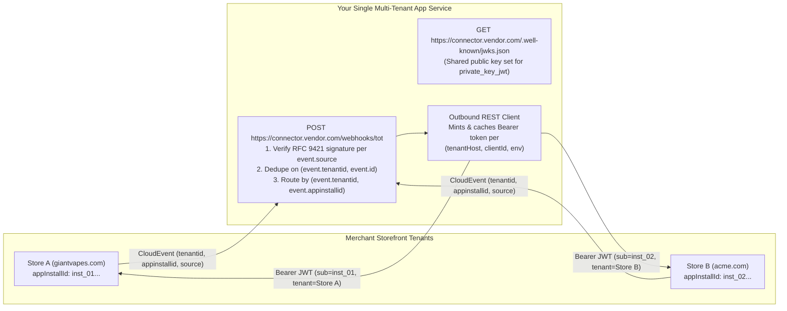

# Hosting & Multi-Tenant Architecture for Storefront Private Apps

A Storefront Private App is **your independently hosted backend service** — written in any language
and deployed on any cloud, serverless runtime, or container platform — communicating with Token of
Trust Storefront over the open v1.3 contract (OAuth2 `client_credentials` / RFC 7523
`private_key_jwt`, OpenAPI 3.1 REST endpoints, and RFC 9421 signed CloudEvents 1.0 webhooks). App
code **never** executes inside the shared Storefront edge Worker.

---

## 1. Multi-Tenant by Design: One Deployed Service Can Serve Many Merchant Stores

While each **installation record** (`appInstallId`) and its granted scopes are authorized per
merchant store and stage (`preview`/`env="test"` vs `publication`/`env="production"`), **you do not
need to deploy a separate server or endpoint per merchant.**

A SaaS vendor (e.g., an inventory/WMS provider, shipping station, or 3PL platform) or a migration
agency managing dozens of stores can run **one shared multi-tenant service and one `tot-app.json`
manifest** across all of its merchant tenants:

### How Multi-Tenant Routing Works on the Wire

| Direction | Wire Attributes Provided by Storefront | How a Multi-Tenant Service Uses Them |
| :--- | :--- | :--- |
| **Inbound Webhooks (`POST webhooks.endpoint`)** | Every signed CloudEvents 1.0 JSON envelope (`asyncapi.yaml` `CloudEventEnvelope`) includes: • **`tenantid`** (required): merchant tenant ID • **`appinstallid`** (required): target installation ID • **`source`** (required): `/tenants/<tenant>/storefront` • **`id`** (required): unique event ID • **`Signature-Input`**: `keyid` of the gateway signing key | 1. Read the raw request bytes and parse the JSON envelope. 2. Resolve the tenant's gateway signing keys from `https://<tenant-host>/.well-known/tot-app-authorization-metadata` (cached by `(tenantid, keyid)`). 3. Verify `Content-Digest` (RFC 9530) and `Signature` (RFC 9421) **before** acting on the payload. 4. Deduplicate deliveries by composite key **`(tenantid, id)`**. 5. Look up the merchant's account/warehouse mapping in your database by **`(tenantid, appinstallid)`**. |
| **Outbound OAuth2 Token Exchange (`POST /api/apps/oauth/token`)** | With **`clientAuth.method: "private_key_jwt"`**, your `tot-app.json` points to a single `jwksUri` (e.g., `https://connector.vendor.com/.well-known/jwks.json`). When an owner approves your staged candidate on Store A or Store B, the platform records your public keys for that store's install and returns its `clientId` and `installId`. | 1. Store `{ tenantId, storefrontOrigin, env, installId, clientId }` in your tenant table when each store install is activated. 2. To call `/api/apps/v1/*` for Store A, sign a 60-second `private_key_jwt` assertion with `iss = sub = <Store-A-clientId>` and `aud = "https://<store-a-host>/api/apps/oauth/token"`. 3. Cache the returned Bearer token keyed by **`(tenantId, installId, env)`** until `expires_in`. |
| **Outbound REST Calls (`/api/apps/v1/*`)** | The Bearer token minted by `/api/apps/oauth/token` cryptographically binds `tenant`, `sub` (`appInstallId`), `env` (`test` \| `production`), and `scopes`. | Send `Authorization: Bearer <tenant-scoped-token>` to `https://<tenant-host>/api/apps/v1/...`. The Storefront gateway enforces stage and tenant isolation automatically (`403 stage_mismatch` or `401 invalid_token` if a token is ever sent to the wrong host or stage). |

---

## 2. Hosting Topologies & Provider Catalog

> **For Coding Agents & Developers:** This directory (`apps/private/hosting/`) is the extensible
> catalog for runtime- and cloud-specific deployment instructions. Read the machine index at
> [`apps/private/hosting/index.json`](./index.json) and list the subdirectories of
> `apps/private/hosting/` to discover all available provider guides — additional cloud runners and
> niche platform guides are added as subdirectories here without modifying the core contract docs.

### Choose Your Topology

| Topology | When to Choose It | First-Class Guides in This Directory |
| :--- | :--- | :--- |
| **1. Edge Serverless Isolates** | Lowest latency and ops overhead; native Web Crypto (`crypto.subtle`); built-in cron triggers; global edge routing. | • **Cloudflare:** [`cloudflare-workers/`](./cloudflare-workers/README.md) (`fetch` + `scheduled` Cron + KV / D1 / Durable Objects) |
| **2. Cloud Function-as-a-Service (FaaS)** | Your team standardizes on AWS, Google Cloud, or Microsoft Azure serverless functions with managed NoSQL/KV and secret vaults. | • **AWS:** [`aws-lambda/`](./aws-lambda/README.md) (Lambda Function URL / HTTP API v2 + EventBridge + DynamoDB) • **Google Cloud:** [`google-cloud-run/`](./google-cloud-run/README.md) (Cloud Run functions + Cloud Scheduler + Firestore) • **Microsoft Azure:** [`microsoft-azure-functions/`](./microsoft-azure-functions/README.md) (Azure Functions v4 HTTP & Timer Triggers + Table/Cosmos DB) |
| **3. Managed & Serverless Containers** | You run a portable Node/Python/Go/Rust HTTP service or multi-tenant SaaS connector packaged with a `Dockerfile`. | • **Google Cloud:** [`google-cloud-run/`](./google-cloud-run/README.md) (Cloud Run Service + Cloud Run Jobs) • **Microsoft Azure:** [`microsoft-azure-functions/`](./microsoft-azure-functions/README.md) (Azure Container Apps) • **Portable OCI / Docker:** [`containers-and-tunnels/`](./containers-and-tunnels/README.md) (`Dockerfile` for Fly.io, AWS App Runner/ECS, Render, Railway, GKE, AKS) |
| **4. Pull-Only Scheduled Jobs (No Inbound Webhook Endpoint)** | Your integration only syncs on a schedule (e.g., periodic `PUT /inventory/levels` or polling `GET /orders`) and does not subscribe to webhooks. | • **Pull-Only & Tunnels:** [`containers-and-tunnels/`](./containers-and-tunnels/README.md#pull-only-scheduled-connectors-zero-inbound-endpoints) (Cloud Run Jobs, EventBridge/Lambda, GitHub Actions, Worker Cron) |
| **5. Local `env="test"` Preview Tunneling** | You are iterating locally with `node server.js` and want a live `preview` store (`tot app install --env test`) to deliver real webhooks to your laptop. | • **Local Tunnels:** [`containers-and-tunnels/`](./containers-and-tunnels/README.md#local-preview-tunneling-for-envtest) (`cloudflared tunnel`, Microsoft `devtunnel`, `ngrok`) |

---

## 3. Five Non-Negotiable Rules Across Every Hosting Provider

Regardless of whether you deploy on Cloudflare, AWS, Google Cloud, Microsoft Azure, or your own
Kubernetes cluster, every Private App host must preserve these five invariants:

1. **Preserve the exact raw request body bytes before JSON parsing:**
   RFC 9530 `Content-Digest` (`sha-256=:...:`) is computed over the exact wire bytes of the HTTP POST
   body. If an API gateway, Express/body-parser middleware, or FaaS wrapper parses and re-serializes
   JSON (changing whitespace or key order) before your verifier runs, signature verification will
   fail. Always read the raw `ArrayBuffer` / `Buffer` first.
2. **Reconstruct the exact public `@target-uri`:**
   RFC 9421 signs `@method`, `@target-uri`, and `content-digest`. Behind a reverse proxy, load
   balancer, or serverless gateway (Cloud Run, Azure Container Apps, AWS API Gateway, Fly.io),
   reconstruct the public HTTPS URL from `x-forwarded-proto` (`https`), `x-forwarded-host` / `host`,
   and the original path + query string — or pin your known `WEBHOOK_PUBLIC_URL`.
3. **Persist CloudEvent deduplication keys (`(tenantid, id)`) outside isolate/process memory:**
   Webhook delivery is at-least-once. Serverless isolates (Cloudflare Workers, Lambda, Cloud Run,
   Azure Functions) spin up multiple instances and evict memory at any time. Store processed
   `(tenantid, event.id)` keys in a shared durable store (KV, D1, DynamoDB, Firestore, Azure Table
   Storage, Redis, or Postgres) with a 7-day TTL.
4. **Run a 5-minute scheduled reconciliation pass:**
   Webhooks are notifications, not the source of truth. Configure a 5-minute timer/cron trigger on
   your host to poll `GET /api/apps/v1/fulfillment/assignments` (or `GET /api/apps/v1/orders` /
   `GET /api/apps/v1/inventory` with `updatedSince`) so any delivery delayed by a transient network
   blip is recovered automatically.
5. **Never log or persist decrypted customer PII (`shipTo`):**
   `GET /api/apps/v1/fulfillment/orders/{orderId}/recipient` returns the decrypted shipping address
   for fulfillment. Keep `shipTo` in a local variable for the duration of the outbound carrier/WMS
   call only — never write it to `console.log`, CloudWatch, Cloud Logging, Application Insights, or
   unencrypted disks.

---

## 4. Open Invitation: Contribute a Hosting Guide for Another Runtime or Cloud

Using a serverless runner, PaaS, or edge platform not listed in [`index.json`](./index.json) (for
example Vercel Functions, Deno Deploy, Fastly Compute, DigitalOcean App Platform, HashiCorp Nomad,
or a framework-specific adapter)?

We welcome pull requests from partners, agencies, and platform vendors! Because `apps/private/hosting/`
is self-indexed, you can add a new hosting guide **without touching the core Private Apps contract
files**:

1. **Create a new directory** at `apps/private/hosting/<provider-slug>/` (kebab-case).
2. **Add `README.md`** covering the five standard sections:
   - **When to use this runtime** (single-tenant and multi-tenant considerations)
   - **Minimal handler / configuration snippet** (showing raw-body `Content-Digest` + RFC 9421 verification)
   - **Secret & `private_key_jwt` key storage** (how credentials are stored server-side)
   - **Scheduled reconciliation setup** (5-minute cron/timer configuration)
   - **Durable `(tenantid, id)` deduplication store**
3. **Register the guide** by adding one entry to the `providers` array in
   [`apps/private/hosting/index.json`](./index.json).
4. **Keep it source-safe and zero-credential**: use placeholder URLs (`example.com`,
   `<tenant>.tokenoftrust.store`) and RFC-reserved test data only (see
   [`../../../CONTRIBUTING.md`](../../../CONTRIBUTING.md)).
